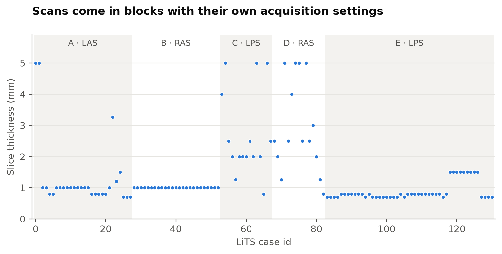
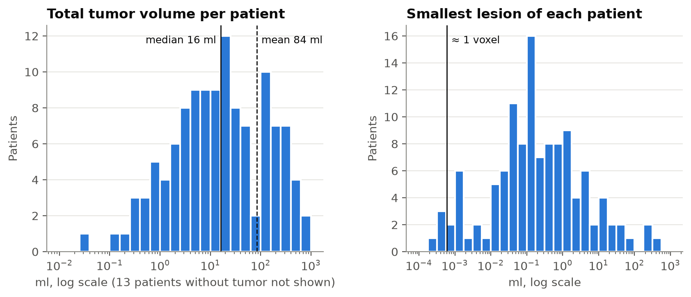

# Liver Tumor Segmentation on CT

[](https://github.com/yanishalloum/liver_tumor_classification/actions/workflows/ci.yml)


Segmentation of the **liver and liver tumors** in abdominal CT scans (LiTS dataset), built
with PyTorch and [MONAI](https://monai.io/). A patient-level *"tumor / no tumor"* decision
is derived from the predicted segmentation, so the model says not only **whether** there is
a lesion but **where** it is and **how large** it is.

> **Status: work in progress.** This is a full rewrite of an earlier 2D slice-classification
> project. The original version is preserved on the branch
> [`v0-legacy`](https://github.com/yanishalloum/liver_tumor_classification/tree/v0-legacy);
> its shortcomings (notably patient leakage between train and test) are documented in
> [`docs/legacy-audit.md`](docs/legacy-audit.md).

## Roadmap

- [x] **0. Foundations** — packaging (`uv`), linting (`ruff`), tests (`pytest`), CI, audit of v0
- [x] **1. Data** — per-case statistics, exploratory analysis, patient-level split balanced on acquisition group and tumor burden
- [ ] **2. Preprocessing** — HU windowing, spacing resampling, MONAI transform pipeline
- [ ] **3. 2D baseline** — U-Net on axial slices, Dice + cross-entropy loss, experiment tracking
- [ ] **4. 3D models** — SegResNet / 3D U-Net with patch sampling, then an nnU-Net v2 reference
- [ ] **5. Evaluation** — Dice, lesion-wise detection, patient-level sensitivity/specificity
- [ ] **6. Inference & demo** — CLI, sliding-window inference, interactive demo, Docker
- [ ] **7. Model card** — limitations, intended use, results table

## Quickstart

Requires [uv](https://docs.astral.sh/uv/).

```bash
git clone https://github.com/yanishalloum/liver_tumor_classification.git
cd liver_tumor_classification
uv sync --group dev          # creates .venv and installs dependencies
uv run pytest                # run the test suite
```

Training dependencies (PyTorch, MONAI) are added in step 2: `uv sync --extra train`.

## Data

[LiTS](https://doi.org/10.1016/j.media.2022.102680): 131 contrast-enhanced abdominal CT
volumes with voxel-wise labels (0 = background, 1 = liver, 2 = tumor), from 7 clinical
sites. The data is not redistributed here; the Kaggle mirrors
[`andrewmvd/liver-tumor-segmentation`](https://www.kaggle.com/datasets/andrewmvd/liver-tumor-segmentation)
and [`…-part-2`](https://www.kaggle.com/datasets/andrewmvd/liver-tumor-segmentation-part-2)
are used for training.

```bash
# per-case geometry and label statistics (reads label volumes + image headers only)
livertumor stats --data-root /path/to/lits --out lits_stats.csv
# stratified patient-level split, versioned in splits/
livertumor split --stats lits_stats.csv --out splits/lits_split.json
```

### What the data looks like

Per-case statistics of all 131 scans are in [`splits/lits_stats.csv`](splits/lits_stats.csv)
(figures: [`scripts/make_eda_figures.py`](scripts/make_eda_figures.py)).



- **Heterogeneous geometry.** In-plane pixels range from 0.56 to 1.0 mm and slice
  thickness from 0.7 to 5 mm (median 0.77 × 0.77 × 1.0 mm). Scans must be resampled to a
  common spacing before training.
- **Acquisition groups.** Consecutive case ids share orientation (LAS / RAS / LPS) and
  scanner settings, consistent with LiTS pooling data from several hospitals. We infer
  5 groups (A–E) from these runs; they are an inference, not official site labels.
  Orientations differ, so volumes must also be reoriented to a common convention.



- **Long-tailed tumor burden.** 13 patients have no tumor; among the others, total tumor
  volume spans five orders of magnitude (median 16 ml, mean 84 ml).
- **Extreme class imbalance.** Tumor is a median 0.7% of the liver and far less of the
  scan, so accuracy is meaningless; we use Dice-based losses and metrics.
- **Tiny lesions.** Many patients have lesions under 0.01 ml (a few voxels); some are
  likely annotation artefacts. Lesion-wise metrics will need a minimum-size rule.

### Train / validation / test split

[`splits/lits_split.json`](splits/lits_split.json) is shared by every experiment.

1. **Per patient**, never per slice (the legacy version leaked neighbouring slices).
2. **Balanced on acquisition group:** inside each group, patients are sorted by tumor
   volume and dealt to train/val/test with a randomly rotated pattern (systematic
   sampling), so every group appears in exact proportion and tumor sizes are spread.
3. **Re-randomisation:** among 1,000 candidate seeds, the one with the most even tumor
   strata is kept. The criterion uses data balance only and was fixed before any training.

| | train | val | test |
|---|---:|---:|---:|
| Patients | 85 | 19 | 27 |
| Groups A / B / C / D / E | 18 / 16 / 10 / 10 / 31 | 4 / 4 / 2 / 2 / 7 | 6 / 5 / 3 / 3 / 10 |
| No tumor / small / medium / large | 8 / 25 / 26 / 26 | 2 / 6 / 5 / 6 | 3 / 8 / 8 / 8 |

## Compute

Code is developed and tested locally (CPU, synthetic data in CI). Heavy jobs run on
Kaggle GPUs through thin runner notebooks in [`notebooks/`](notebooks/) that only
install this package and call its CLI, so every result can be reproduced on any machine.

## Project structure

```
├── src/livertumor/      # installable package
│   ├── data/            # discovery, per-case statistics, patient-level split
│   ├── intensity.py     # CT windowing
│   └── cli.py           # `livertumor` command
├── notebooks/           # thin Kaggle runners (no logic inside)
├── scripts/             # figure generation
├── splits/              # versioned train/val/test case lists
├── tests/               # unit tests on synthetic NIfTI volumes, run in CI
└── docs/                # design notes and the v0 audit
```

## Results

Coming with step 5. Reference points from the literature (LiTS benchmark): best tumor Dice
≈ 0.74 and liver Dice ≈ 0.96 ([Bilic et al., 2023](https://doi.org/10.1016/j.media.2022.102680)).

## Disclaimer

Research and educational project. **Not a medical device**; not intended for clinical use.

## License

[MIT](LICENSE). The LiTS data has its own licence (CC BY-NC-SA 4.0) and is not redistributed here.
